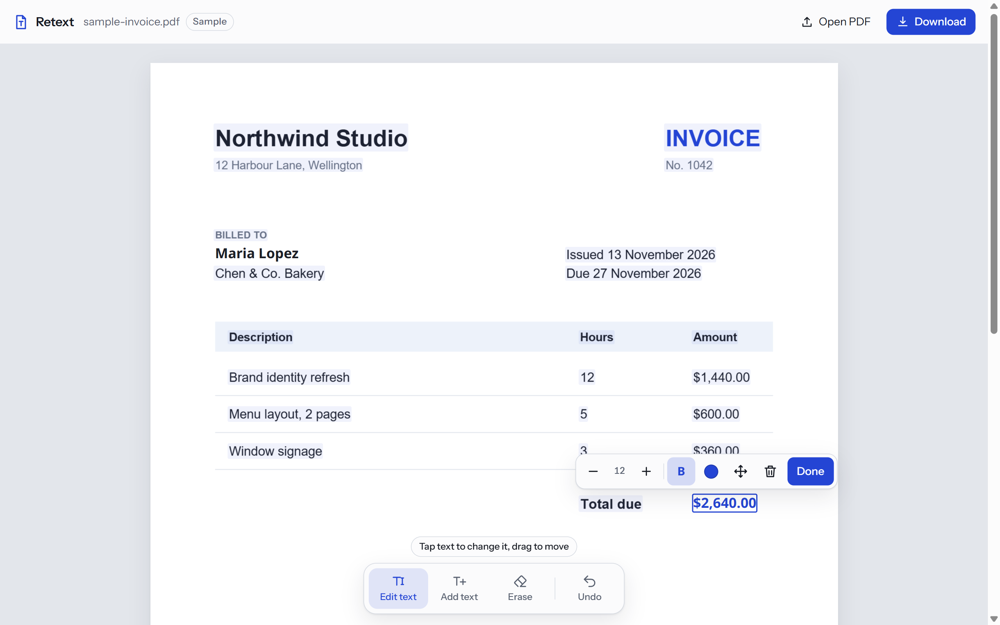
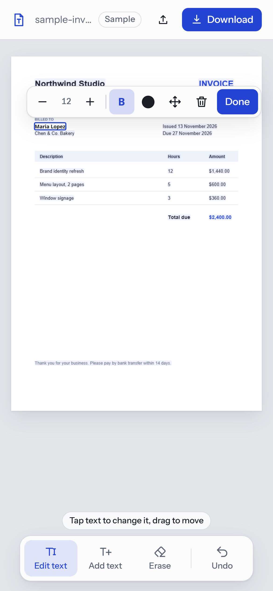

<p align="center">
  
</p>

<h1 align="center">Retext PDF</h1>

<p align="center">
  <b>Edit the text in any PDF, right in your browser.</b><br>
  Free to use. No sign-up. Your files never leave your device.
</p>

<p align="center">
  <a href="https://retext-pdf.vercel.app"><b>Open Retext →</b></a>
</p>

<p align="center">
  
</p>

## Free for everyone

Retext is free, with no account, no limits and no watermark. Use it as much as you like and share it with anyone.

Open **[retext-pdf.vercel.app](https://retext-pdf.vercel.app)** on your phone or computer. On a phone you can add it to your home screen and it opens like an app.

## What you can do

| | |
|---|---|
| **Edit text** | Tap any line and type over it. Change the size, bold or colour. |
| **Move text** | Drag any line to a new spot. |
| **Add text** | Tap anywhere on the page to write something new. |
| **Erase** | Drag over anything to cover it. |
| **Undo** | Step back through every change. |
| **Download** | Save the edited PDF. |

It works with Latin and Cyrillic text, including Mongolian.

<p align="center">
  
</p>

## Private by design

Everything happens inside your browser. There is no server and no upload, so your PDF never goes anywhere. You can check: the whole app is one page, [`index.html`](index.html).

## How it works

Retext draws each page with [PDF.js](https://mozilla.github.io/pdf.js/) and saves your changes with [pdf-lib](https://pdf-lib.js.org/). When you change a line, it covers the old text with a patch in the page's background colour and writes the new text on top.

> [!WARNING]
> The old text is covered, not deleted. It can still be found by search or copy-paste. **Don't use Retext to hide private information.**

## Limits

- New text uses a close match (Noto Sans, Times or Courier), not the PDF's own font.
- Password-protected PDFs can't be saved.
- Lines on rotated pages can't be edited.

## Run it yourself

It's a static site with no build step. Serve the folder with any static server:

```sh
npx serve .
```

## Contributing

Found a bug or have an idea? [Open an issue](https://github.com/tulgax/retext-pdf/issues). Pull requests are welcome.

## Credits

- [PDF.js](https://github.com/mozilla/pdf.js) by Mozilla (Apache 2.0)
- [pdf-lib](https://github.com/Hopding/pdf-lib) (MIT)
- [Noto Sans](https://github.com/notofonts/latin-greek-cyrillic) (SIL Open Font License, see [`fonts/OFL.txt`](fonts/OFL.txt))

## License

[MIT](LICENSE): free to use, copy, change and share.
